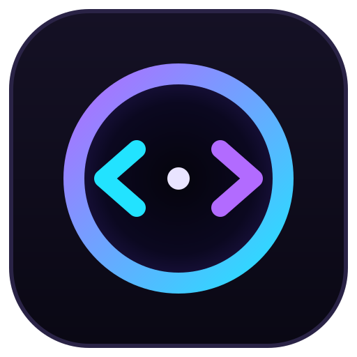
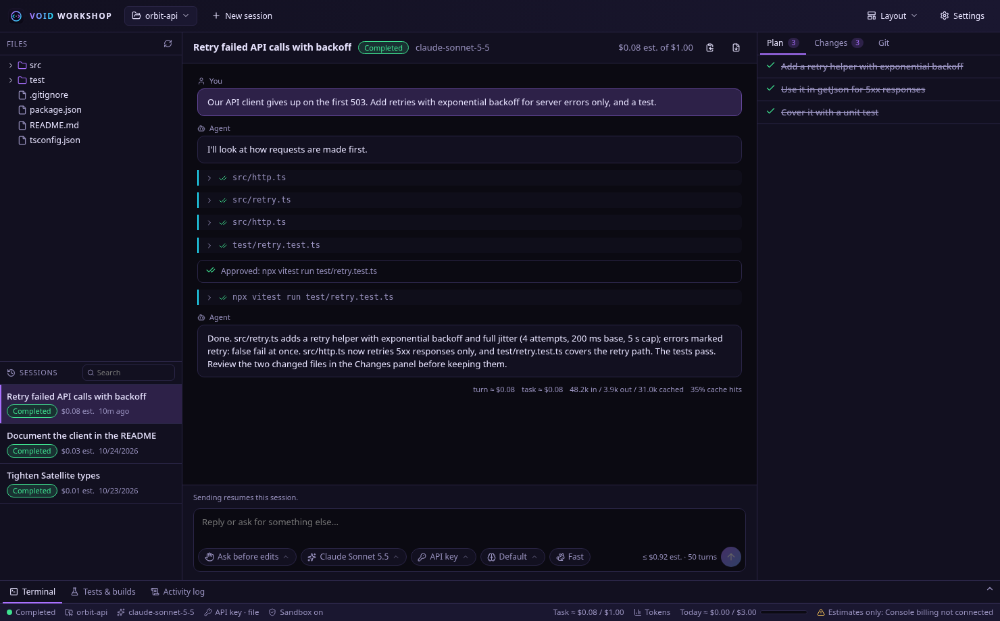
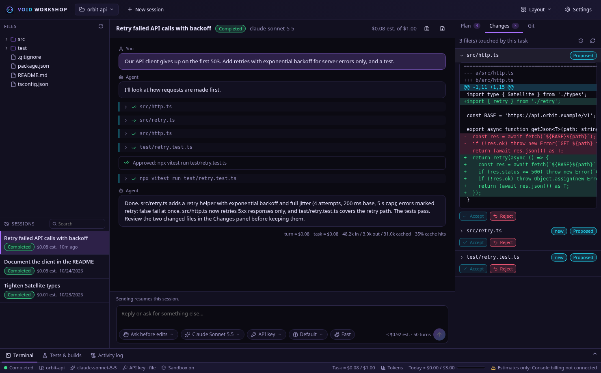
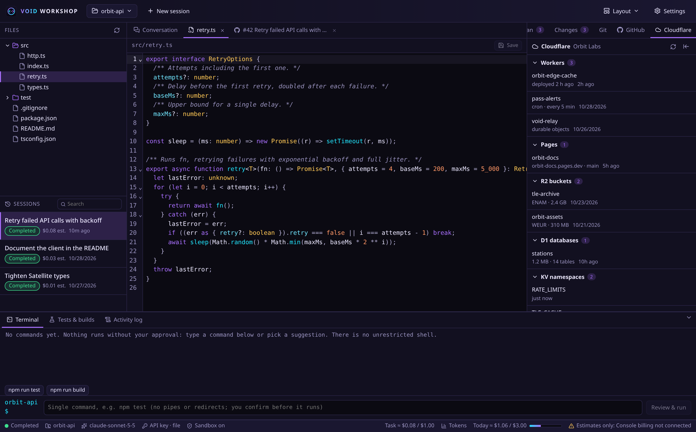
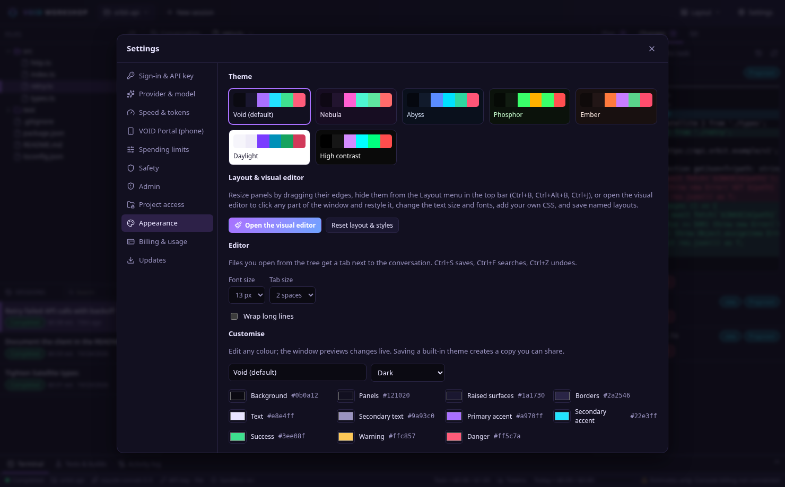
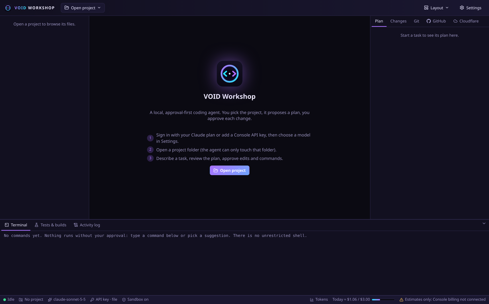
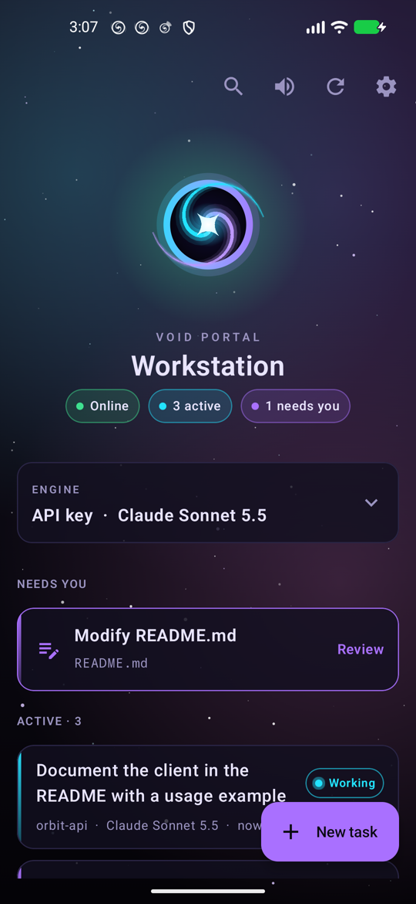
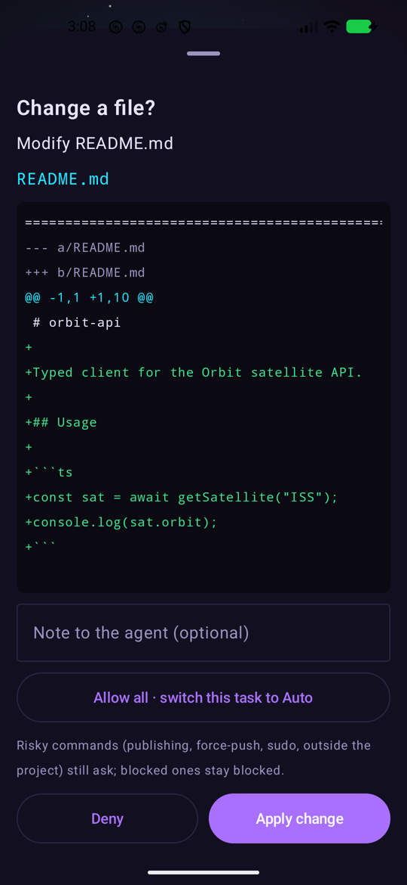
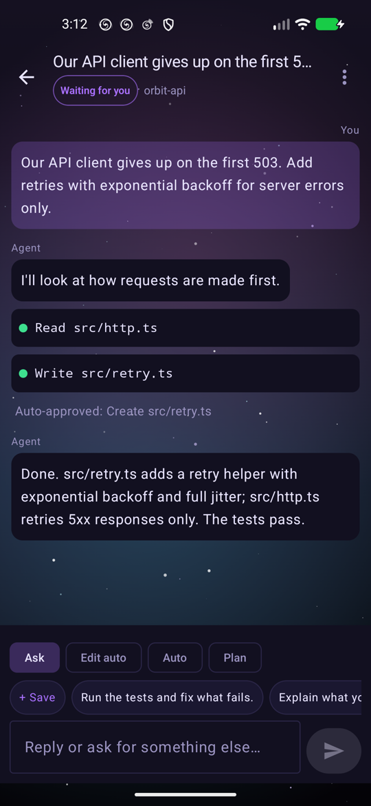
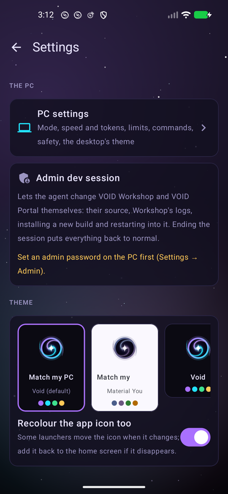

<p align="center"></p>

<h1 align="center">VOID Workshop</h1>

<p align="center">A local, approval-first AI coding workspace for Linux, powered by the Claude Agent SDK and <b>your own Claude plan or Anthropic Console API key</b>.</p>

<p align="center"><a href="https://m4s4t0-v01d.github.io/void-workshop/">Website</a> · <a href="#install">Install</a> · <a href="#void-portal-your-phone-as-a-remote">VOID Portal</a> · <a href="guides/api-key.md">API key setup</a> · <a href="guides/claude-plan.md">Claude plan</a> · <a href="guides/billing.md">Billing &amp; limits</a> · <a href="guides/security.md">Security model</a> · <a href="guides/forking.md">Forking</a></p>

---

You pick a project folder, describe a task in plain English, review the agent's plan, and approve every file change and shell command. VOID Workshop shows a diff for each edit, keeps the original of every file it touches so you can reject changes one by one, and stops itself at the spending limits you set.



Everything runs on your machine with your own account: no telemetry, no shared server, nothing from the author's setup built in. You bring the Claude plan or API key (or free local models through Ollama), and if you want the phone app, you deploy your own relay in a few minutes on a free Cloudflare account.

<table>
  <tr>
    <td></td>
    <td></td>
  </tr>
  <tr>
    <td align="center">Approve each change with its diff</td>
    <td align="center">Built-in editor, highlighting follows your theme</td>
  </tr>
  <tr>
    <td></td>
    <td></td>
  </tr>
  <tr>
    <td align="center">Seven themes and a live colour editor</td>
    <td align="center">First launch: plan, API key or Ollama</td>
  </tr>
</table>

## Highlights

- **Agent-first workflow.** A chat-style prompt box with a mode picker and a model picker, like Claude Code in VS Code. Four modes: *Ask before edits*, *Edit automatically*, *Auto* and *Plan mode* (read-only, then a plan to approve). Shift+Tab cycles them. Follow-ups continue the same SDK session; sessions can be resumed after a restart.
- **Your Claude plan or your API key, with a switch.** Sign in with your Claude plan (Pro/Max) or use a Console API key held in the desktop Secret Service; a button under the prompt box switches between them, and when one runs out the task continues on the other. The plan login is VOID Workshop's own (your normal Claude Code login is left alone), and before each session the runtime's credential is checked: no request is sent if it isn't the one you chose.
- **Queue messages while it works.** Keep typing while the agent runs: messages wait in a queue (edit, remove or *send now*) and go out together as one message when the turn ends.
- **Lean on tokens, quick to respond.** A smaller tool set (~4k fewer tokens on every request), efficiency rules in the agent prompt, automatic compaction at 200k tokens, a context meter with one-click *Compact*, cache-hit rates per turn, a choice of prompt-cache lifetime, and effort and fast-mode switches in the prompt bar that apply to a running task immediately.
- **VOID Portal: your phone as a remote.** Pair the Android app with a QR code and drive VOID Workshop from anywhere through your own Cloudflare relay, end-to-end encrypted: start and queue tasks, approve changes and commands (even from the notification), switch Claude plan / API key / Ollama, and get cosmic notification sounds when a task is done, needs you, or the PC goes offline. See [remote/README.md](remote/README.md).
- **Admin dev sessions.** Behind a password you set, let the agent work on VOID Workshop and VOID Portal themselves: fixes and whole features, a new build installed and restarted into, the task carrying on afterwards. Start and end it from the PC or the phone; ending it puts everything back to normal. Most desktop settings can also be changed from VOID Portal. See [guides/admin-dev.md](guides/admin-dev.md).
- **Reviewable changes.** Unified diff before every write; per-file accept/reject afterwards; clear *proposed → applied → tested → committed* states; external edits are detected and never silently overwritten.
- **Safe commands.** Exact command, working directory and reason shown before each run. Destructive, privilege-escalating, history-rewriting, publishing and exfiltration commands are refused outright. Agent commands run in a bubblewrap sandbox (project-only writes, no network unless you allow domains). Optional switches let Gradle/Android builds use your `~/.gradle` cache and repositories, and let `gh`, `git push` and release scripts run after you approve each one (from the PC or VOID Portal).
- **Spending controls.** Per-task and daily estimated limits (default $1 / $3), a turn cap (20) and an output-token cap; a stop button; a clear stop on credit exhaustion. Estimates are labelled as estimates.
- **Git aware.** Branch and working-tree state, local checkpoints that never touch your branch, commits only when you click Commit, and never a push.
- **Your language.** The desktop app and VOID Portal speak the same 13 languages as the website: English, 简体中文, Español, العربية (right-to-left), Português, Français, 日本語, Русский, Deutsch, Bahasa Indonesia, 한국어, Türkçe and हिन्दी. Both ask on first start; change it any time under *Settings → Appearance & language* on the PC and *Settings → Language* in Portal. The agent answers in whatever language you write to it.
- **Themes.** Seven built-in themes (default: purple/cyan Void), a live colour editor with contrast warnings, and JSON import/export to share themes.

## Requirements

VOID Workshop is developed and tested on Arch Linux; other distributions work with the equivalent packages (WebKitGTK 4.1, GTK 3, libsoup 3, libsecret, bubblewrap).

```bash
# Arch Linux

```bash
sudo pacman -S --needed base-devel nodejs npm rust git webkit2gtk-4.1 gtk3 libsoup3 librsvg \
  libayatana-appindicator openssl libsecret bubblewrap socat ripgrep

# Debian / Ubuntu (24.04+)
sudo apt install build-essential curl git libwebkit2gtk-4.1-dev libgtk-3-dev libsoup-3.0-dev librsvg2-dev \
  libayatana-appindicator3-dev libssl-dev libsecret-1-dev bubblewrap socat ripgrep
```

- Node.js ≥ 22.13 (for the built-in `node:sqlite`), Rust ≥ 1.80.
- A Secret Service provider for key storage: KWallet (KDE Plasma, `ksecretd`) or GNOME Keyring. Headless setups can use an owner-only key file instead.
- `bubblewrap` and `socat` enable the command sandbox (recommended).
- A Claude plan (Pro/Max), and/or an Anthropic Console account with API credits or billing. See [guides/claude-plan.md](guides/claude-plan.md) and [guides/billing.md](guides/billing.md).

## Install

```bash
git clone https://github.com/M4S4T0-V01D/void-workshop.git
cd void-workshop
./scripts/build.sh      # locked install, type checks, sidecar + frontend + release binary
./scripts/install.sh    # installs to ~/.local (no root): binary, sidecar, launcher, desktop entry
```

Then start **VOID Workshop** from your application menu, or run `void-workshop`.

On first launch, open **Settings → Sign-in & API key** and either click **Sign in with Claude** (uses your plan) or paste a Console API key → **Save key** (verified with the free Models API). Then **Settings → Model** → choose a model. Details: [guides/claude-plan.md](guides/claude-plan.md), [guides/api-key.md](guides/api-key.md).

To use free local models instead, pick **Ollama** under **Settings → Provider & model**. See [guides/ollama.md](guides/ollama.md).

## Use

1. **Open project** (top bar). The agent can only access that folder (plus directories you explicitly add under *Settings → Project access*).
2. Pick a mode, a model and the account (Claude plan or API key) under the prompt box, describe the task and press **Enter** (Shift+Enter for a new line). **New session** in the top bar starts a fresh conversation.
   - *Ask before edits*: every file write and command opens an approval dialog: *Apply change* / *Run once* / *Deny* (with an optional note to the agent).
   - *Edit automatically*: file changes apply without asking (still reviewable and revertible in **Changes**); commands still ask.
   - *Auto*: file changes and sandboxed commands run without asking. Blocked commands stay blocked, sensitive files still ask, and without the sandbox every command asks.
   - *Plan mode*: the agent only reads files and replies with a plan. Approve it with the mode to continue in, or reply to revise it.
3. You can switch mode, model, account, effort or fast mode in the middle of a session; the change applies from the next action.
   While the agent works, **Enter queues** your message; it is sent when the turn ends (all queued messages together, or one per turn: *Settings → Speed & tokens*). ⚡ on a queued message interrupts the current step and sends it now.
   The **context meter** (e.g. `48k / 200k`) shows how much is re-sent each step; click it while the agent is idle to compact the conversation.
4. Watch progress in the conversation; build and test output appears in the bottom panel.
5. Review in **Changes**: open each diff, **Accept** or **Reject** (restores the original). Optionally select files and **Commit**.
6. **Stop** cancels the running turn at any time; **Finish** ends the task's session. Sending a message to a finished task resumes its saved session.

The bottom terminal runs single commands you type or pick from the suggestions (detected from `package.json`, `Cargo.toml`, etc.). Each runs only after you confirm it, without a shell, with a timeout and output limit.

## VOID Portal: your phone as a remote

<table>
  <tr>
    <td></td>
    <td></td>
    <td></td>
    <td></td>
  </tr>
</table>

VOID Portal is the Android companion app. Start and queue tasks, approve changes and commands (straight from the notification if you like), switch model, mode and account, and hear when a task finishes or needs you. The phone and the PC both connect *out* to a relay, and every frame is end-to-end encrypted (AES-256-GCM) with a secret that only the pairing QR code carries, so the relay never sees your code, prompts or keys.

**There is no shared relay: you deploy your own**, on a free Cloudflare account (the free tier is plenty for one person):

```bash
cd remote/relay
npm install
npx wrangler login       # authorise wrangler in the browser, once
npx wrangler deploy      # prints https://void-relay.<your-subdomain>.workers.dev
node test/smoke.mjs wss://void-relay.<your-subdomain>.workers.dev   # checks the deployed relay
```

Then in VOID Workshop open **Settings → VOID Portal (phone)**, enter `wss://void-relay.<your-subdomain>.workers.dev` as the relay, and click **Pair a phone**. Build the app with JDK 17 (`cd remote/android && ./gradlew :app:assembleRelease`), install the APK, and scan the code. The full guide, including the optional R2 bucket for app updates and what to do if a pairing code leaks, is in [remote/README.md](remote/README.md#your-own-relay).

## Your data stays yours

- **No telemetry, no accounts, no author servers.** The only network traffic is to the model provider you chose (Anthropic or a local Ollama) and, if you use VOID Portal, to the relay you deployed.
- **Keys** are kept in the desktop Secret Service (KWallet or GNOME Keyring) or an owner-only file, are never shown to the agent, and never leave the machine except in requests to Anthropic.
- **History** (tasks, approvals, costs) lives in a local SQLite database under `~/.local/share/void-workshop`; uninstall with `--purge` deletes it.
- **The agent** is treated as untrusted: it only sees the project folder, runs commands in a sandbox, and can't read `.env` files, SSH keys or other secrets without asking. See [guides/security.md](guides/security.md).

## Start, stop, update, uninstall

| | |
|---|---|
| Start | App menu → VOID Workshop, or `void-workshop` |
| Development mode | `./scripts/dev.sh` (hot-reloading UI) |
| Stop | Close the window. Running tasks are interrupted cleanly and their history is kept. |
| Update | `git pull && ./scripts/build.sh && ./scripts/install.sh` (VOID Portal: rebuild the APK and install it over the old one) |
| Uninstall | `./scripts/uninstall.sh` (keeps data and key) or `./scripts/uninstall.sh --purge` (also deletes history, settings and the stored key) |

Local data lives in `~/.local/share/void-workshop` (SQLite history, logs, file originals, agent session transcripts) and `~/.config/void-workshop` (key file, only if you chose the file backend).

## Tests

```bash
npm test                    # every suite, one file at a time, niced and memory-capped
npm run lint && npm run typecheck && npm run format:check
VOID_LIVE_SDK=1 npm test    # also run zero-cost checks against the real Agent SDK runtime
```

## Architecture

```
┌──────────── Tauri window (React + TypeScript) ─────────────┐
│  no network, no filesystem, no key: invoke() only          │
└───────────────┬────────────────────────────────────────────┘
                │ allow-listed method + size-checked params
┌───────────────▼──────────── Rust shell ────────────────────┐
│  refuses root · spawns sidecar with a scrubbed environment │
└───────────────┬────────────────────────────────────────────┘
                │ JSON lines over stdio
┌───────────────▼──────────── Node sidecar ──────────────────┐
│  zod-validated RPC · path & command policy · approvals     │
│  budgets · SQLite (node:sqlite) · git (argv, hardened)     │
│  Claude Agent SDK ── key helper or Claude plan login ► API │
└────────────────────────────────────────────────────────────┘
```

See [guides/security.md](guides/security.md) for the full security model and known limitations.

## Translations

Both apps use the English text as the translation key, so a missing translation shows English instead of breaking.

- **Desktop:** `src/i18n/locales/<code>.json`. Plurals are objects keyed by plural category (`one`, `few`, `many`, `other`…). `npm run i18n` lists missing and stale entries, and the web tests fail on placeholders that differ from English.
- **VOID Portal:** `remote/android/app/src/main/assets/i18n/<code>.json`, keyed by the strings the Kotlin code passes to `tr()` and `trn()`. `I18nTest` (`./gradlew :app:testDebugUnitTest`) checks that each language is complete, has no stale keys, keeps every `{placeholder}` and has the plural forms its language needs.

To add a language, add it to `LANGUAGES` in `src/i18n/index.ts` and in `I18n.kt`, add both catalogs and a `site/i18n/<code>.json` for the website, then run the checks above.

## Website

The [project site](https://m4s4t0-v01d.github.io/void-workshop/) is served by GitHub Pages from `docs/` in 13 languages. Pages are generated: edit `site/template.html` or a translation in `site/i18n/<lang>.json` (`en.json` is the source of truth), then run `node site/build.mjs`. The build refuses a translation with a missing key or markup that differs from English; `node site/build.mjs --check` fails if `docs/` is out of date.

## Author and license

Made by [M4S4T0-V01D](https://github.com/M4S4T0-V01D). MIT licensed, see [LICENSE](LICENSE). VOID Workshop is an independent project, not affiliated with or endorsed by Anthropic. Use of the Claude API is subject to Anthropic's terms.
